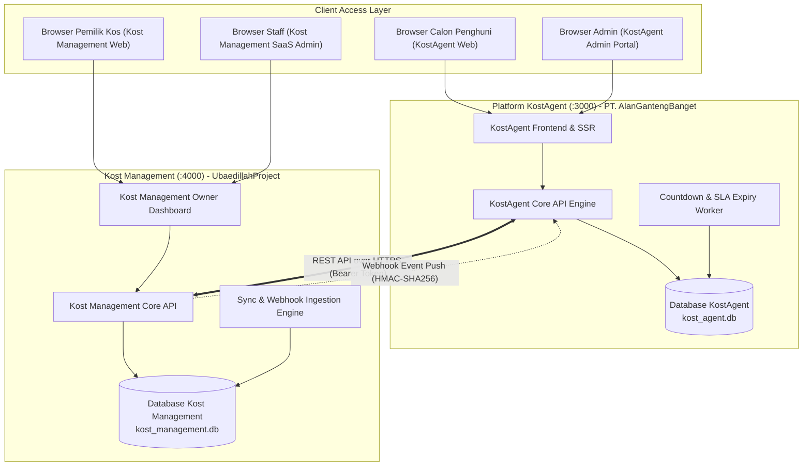
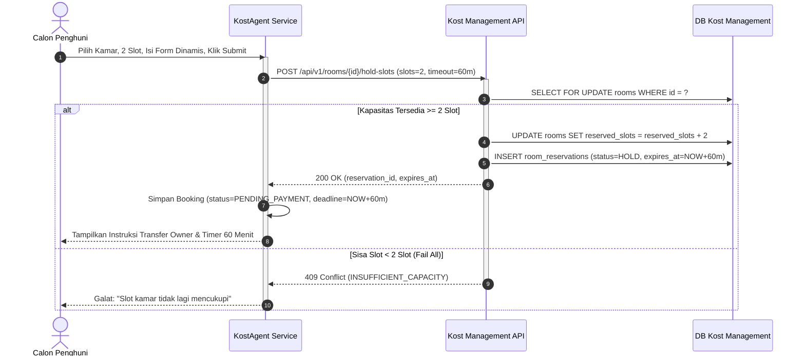
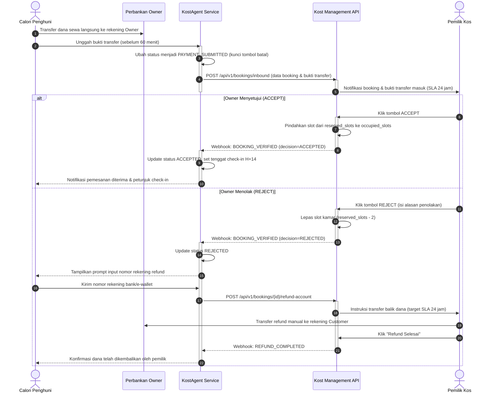

# DOKUMEN ARSITEKTUR SISTEM (SYSTEM ARCHITECTURE SPECIFICATION)
## SISTEM TERPADU: KOST MANAGEMENT & KOSTAGENT
**Phase**: Phase 2 — System Analysis  
**Versi**: 1.0.0 | **Tanggal**: 2026-11-01  
**Referensi**: [ADR-000 s/d ADR-012](file:///e:/Allan/Kuliah/Kuliah%20Sem%203/Integrasi%20Sistem/Golden%20Tiket/kost-agent/docs/decisions/README.md) & [functional-requirements.md](file:///e:/Allan/Kuliah/Kuliah%20Sem%203/Integrasi%20Sistem/Golden%20Tiket/kost-agent/docs/requirements/functional-requirements.md)

---

## 1. TOPOLOGI & MONOREPO DUAL-SERVICE (ADR-007)

Kedua sistem hidup dalam satu repositori kerja (*monorepo*) namun beroperasi sebagai dua aplikasi mandiri dengan database dan konfigurasi independen:

```text
kost-agent/ (Monorepo Root)
├── apps/
│   ├── kost-management/            # Aplikasi SaaS Operasional Pemilik Kos (UbaedillahProject)
│   │   ├── src/                    # Backend API & Frontend Dashboard Owner
│   │   ├── prisma/                 # Schema & Migrasi DB Kost Management (kost_management.db)
│   │   ├── .env                    # PORT=4000, DB_URL, PLATFORM_SECRET
│   │   └── package.json
│   │
│   └── kost-agent/                 # Platform Publik Agregasi & Booking (PT. AlanGantengBanget)
│       ├── src/                    # Backend API & Portal Publik Customer/Admin
│       ├── prisma/                 # Schema & Migrasi DB KostAgent (kost_agent.db)
│       ├── .env                    # PORT=3000, DB_URL, PLATFORM_SECRET
│       └── package.json
│
├── docs/                           # Dokumentasi Arsitektur, DB, API, Keputusan Teknis
└── package.json                    # Workspace scripts (pnpm / npm workspaces)
```



---

## 2. SEQUENCE DIAGRAMS (ALUR BISNIS UTAMA)

### 2.1 Alur Inisiasi Booking & Real-Time Hold Kamar (ADR-008)



### 2.2 Alur Pembayaran Direct to Owner & Verifikasi Owner



---

## 3. STACK TEKNOLOGI REKOMENDASI UNTUK MVP (SOLO DEV FRIENDLY)

Untuk memaksimalkan produktivitas pengerjaan individu, meminimalkan kompleksitas infrastruktur, dan menjamin performa tinggi:

1. **Runtime & Bahasa**: **Node.js (v20+ LTS) dengan TypeScript**.  
   *Alasan*: Type-safety penuh antara frontend dan backend, ekosistem npm kaya, parsing JSON skema dinamis sangat cepat.
2. **Framework Backend**: **Fastify** atau **Express.js** dengan struktur modular.
3. **Database & ORM**: **Prisma ORM** dengan **SQLite (Lokal Dev)** atau **PostgreSQL**.
   *Alasan*: Prisma menghasilkan type-safe database client otomatis, file migration declarative, dan sangat mudah mengelola dua skema terpisah (`km_db` dan `ka_db`).
4. **Validasi Skema**: **Zod**.  
   *Alasan*: Validasi runtime yang selaras dengan TypeScript types untuk kontrak API, form dinamis, dan webhook validation.
5. **Frontend UI**: **Next.js (App Router)** atau **Vite + React + Tailwind CSS**.  
   *Alasan*: Komponen antarmuka modern, responsif, dan ringan untuk dashboard pemilik maupun portal publik pencari kos.
6. **Task Scheduling / Timers**: **Node-Cron** atau in-process lightweight scheduler untuk monitoring deadline 60 menit dan SLA verifikasi 24 jam.

Dokumen arsitektur sistem ini memformalkan integrasi menyeluruh antar-modul dan siap dilanjutkan ke tahap **Perancangan Wireframe / UI-UX Flow** sebelum masuk ke fase implementasi kode.
