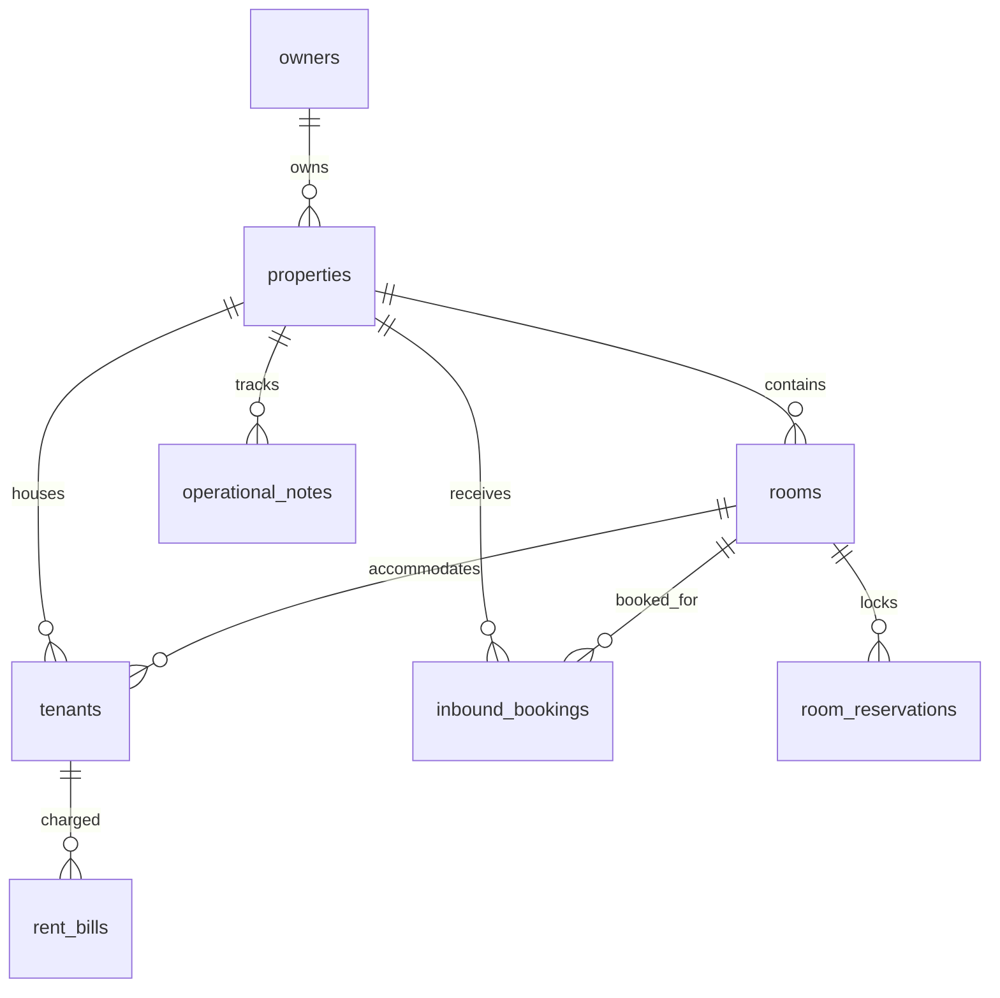
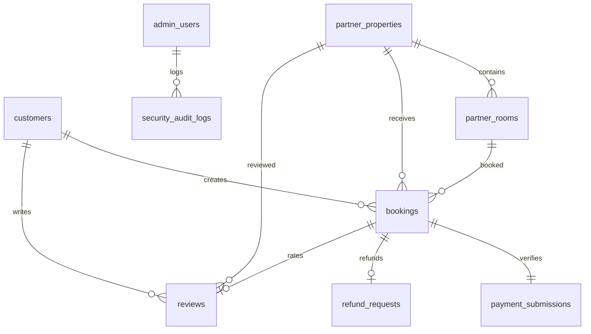

# PERANCANGAN DATABASE & ENTITY RELATIONSHIP DIAGRAM (ERD)
## SISTEM TERPADU: KOST MANAGEMENT & KOSTAGENT
**Phase**: Phase 2 — System Analysis  
**Versi**: 1.0.0 | **Tanggal**: 2026-11-01  
**Prinsip Arsitektur**: Database Terpisah 100% (Zero Direct DB Access, ADR-000 & ADR-007)

---

## 1. STRUKTUR DAN ISOLASI DATABASE

Sistem memiliki dua database independen:
1. **`kost_management_db`**: Database operasional milik UbaedillahProject yang menaungi data multi-tenant pemilik kos, kamar, operasional penyewa internal, dan transaksi booking inbound.
2. **`kost_agent_db`**: Database platform publik milik PT. AlanGantengBanget yang menaungi data customer, katalog publik properti kemitraan, proses checkout booking, bukti bayar, ulasan, dan log keamanan.

```mermaid
flowchart LR
    subgraph KostManagementDB["Database Kost Management (kost_management_db)"]
        KM_Owners[owners]
        KM_Properties[properties]
        KM_Rooms[rooms]
        KM_Tenants[tenants]
        KM_Bills[rent_bills]
        KM_Reservations[room_reservations]
        KM_Inbound[inbound_bookings]
        KM_Notes[operational_notes]
    end

    subgraph KostAgentDB["Database KostAgent (kost_agent_db)"]
        KA_Customers[customers]
        KA_Admins[admin_users]
        KA_Properties[partner_properties]
        KA_Rooms[partner_rooms]
        KA_Bookings[bookings]
        KA_Payments[payment_submissions]
        KA_Refunds[refund_requests]
        KA_Reviews[reviews]
        KA_Audits[security_audit_logs]
    end

    KostManagementDB <== "REST API & Webhooks (Tanpa Direct DB Link)" ==> KostAgentDB
```



---

## 2. DATABASE KOST MANAGEMENT (`kost_management_db`)

### 2.1 Entity Relationship Diagram (Kost Management)



### 2.2 Spesifikasi Skema Tabel Kost Management

#### Tabel: `owners`
Mencatat akun pemilik kos pengguna SaaS Kost Management.
- `id` (UUID, Primary Key)
- `email` (VARCHAR(150), Unique, Not Null)
- `password_hash` (VARCHAR(255), Not Null)
- `full_name` (VARCHAR(100), Not Null)
- `phone_number` (VARCHAR(20), Not Null)
- `subscription_status` (VARCHAR(20), Default: 'ACTIVE') — Enum: `ACTIVE`, `GRACE_PERIOD`, `EXPIRED`, `SUSPENDED`
- `subscription_expires_at` (TIMESTAMP, Nullable)
- `created_at` (TIMESTAMP, Default: CURRENT_TIMESTAMP)
- `updated_at` (TIMESTAMP, Default: CURRENT_TIMESTAMP)

#### Tabel: `properties`
Mencatat unit kos milik owner (Source of Truth profil kos).
- `id` (UUID, Primary Key)
- `owner_id` (UUID, Foreign Key -> `owners.id`, Indexed)
- `name` (VARCHAR(150), Not Null)
- `slug` (VARCHAR(160), Unique, Not Null)
- `address` (TEXT, Not Null)
- `city` (VARCHAR(100), Not Null, Indexed)
- `district` (VARCHAR(100), Not Null)
- `latitude` (DECIMAL(10, 8), Nullable)
- `longitude` (DECIMAL(11, 8), Nullable)
- `description` (TEXT, Nullable)
- `gender_type` (VARCHAR(20), Default: 'MIXED') — Enum: `MALE`, `FEMALE`, `MIXED`
- `general_facilities` (JSON, Not Null) — Array string fasilitas: `["Wi-Fi", "Parkir Mobil", "Dapur Bersama"]`
- `photos` (JSON, Not Null) — Array URL foto properti
- `contact_phone` (VARCHAR(20), Not Null)
- `whatsapp_number` (VARCHAR(20), Not Null)
- `requirements_schema` (JSON, Not Null) — Skema ketentuan dinamis (ADR-009):
  ```json
  {
    "standard_presets": {
      "ktp_required": true,
      "kk_required": false,
      "proof_of_employment": true,
      "emergency_contact": true
    },
    "custom_checkboxes": [
      { "id": "cb_motor", "label": "Membawa Sepeda Motor", "is_required": false },
      { "id": "cb_smoker", "label": "Bukan Perokok Aktif", "is_required": true }
    ],
    "notes": "Dilarang membawa hewan peliharaan. Jam malam pukul 23:00 WIB."
  }
  ```
- `payment_bank_name` (VARCHAR(50), Not Null) — Rekening penerimaan dana direct-to-owner
- `payment_account_number` (VARCHAR(50), Not Null)
- `payment_account_holder` (VARCHAR(100), Not Null)
- `payment_qris_url` (VARCHAR(255), Nullable)
- `partnership_status` (VARCHAR(20), Default: 'NONE') — Enum: `NONE`, `WAITING_REVIEW`, `APPROVED`, `REJECTED`, `SUSPENDED`
- `rejection_reason` (TEXT, Nullable)
- `created_at` (TIMESTAMP, Default: CURRENT_TIMESTAMP)
- `updated_at` (TIMESTAMP, Default: CURRENT_TIMESTAMP)

#### Tabel: `rooms`
Mencatat kamar kos dan kuota kapasitas slot (Source of Truth ketersediaan).
- `id` (UUID, Primary Key)
- `property_id` (UUID, Foreign Key -> `properties.id`, Indexed)
- `room_number` (VARCHAR(50), Not Null)
- `room_type` (VARCHAR(20), Not Null) — Enum: `PRIVATE`, `SHARED`
- `size_sqm` (DECIMAL(5, 2), Nullable) — Ukuran kamar ($m^2$)
- `facilities` (JSON, Not Null) — Array fasilitas: `["AC", "Kamar Mandi Dalam", "Kasur Springbed"]`
- `photos` (JSON, Not Null) — Array URL foto kamar
- `monthly_price` (DECIMAL(12, 2), Not Null) — Tarif sewa per slot/bulan (ADR-004)
- `total_capacity` (INT, Not Null, Default: 1) — Kapasitas total orang/slot (ADR-010)
- `occupied_slots` (INT, Not Null, Default: 0) — Slot yang dihuni penghuni aktif
- `reserved_slots` (INT, Not Null, Default: 0) — Slot yang sedang di-hold transaksi aktif (ADR-008)
- `status` (VARCHAR(20), Default: 'AVAILABLE') — Enum: `AVAILABLE`, `MAINTENANCE`
- `created_at` (TIMESTAMP, Default: CURRENT_TIMESTAMP)
- `updated_at` (TIMESTAMP, Default: CURRENT_TIMESTAMP)
- *Constraint*: `CHECK (total_capacity >= (occupied_slots + reserved_slots))`
- *Constraint*: `UNIQUE (property_id, room_number)`

#### Tabel: `room_reservations`
Mencatat penahanan slot sementara real-time 60 menit (ADR-008).
- `id` (UUID, Primary Key)
- `room_id` (UUID, Foreign Key -> `rooms.id`, Indexed)
- `booking_reference_id` (VARCHAR(100), Not Null, Indexed) — ID booking dari KostAgent
- `slots_count` (INT, Not Null)
- `status` (VARCHAR(20), Default: 'HOLD') — Enum: `HOLD`, `CONFIRMED`, `RELEASED`
- `expires_at` (TIMESTAMP, Not Null, Indexed) — $T + 60$ menit
- `created_at` (TIMESTAMP, Default: CURRENT_TIMESTAMP)
- `updated_at` (TIMESTAMP, Default: CURRENT_TIMESTAMP)

#### Tabel: `tenants`
Mencatat penghuni kamar kos (operasional internal owner).
- `id` (UUID, Primary Key)
- `property_id` (UUID, Foreign Key -> `properties.id`, Indexed)
- `room_id` (UUID, Foreign Key -> `rooms.id`, Indexed)
- `full_name` (VARCHAR(100), Not Null)
- `phone_number` (VARCHAR(20), Not Null)
- `id_card_number` (VARCHAR(30), Nullable)
- `emergency_contact` (VARCHAR(50), Nullable)
- `start_date` (DATE, Not Null)
- `due_date` (DATE, Not Null)
- `monthly_rent` (DECIMAL(12, 2), Not Null)
- `status` (VARCHAR(20), Default: 'ACTIVE') — Enum: `ACTIVE`, `CHECKED_OUT`
- `created_at` (TIMESTAMP, Default: CURRENT_TIMESTAMP)
- `updated_at` (TIMESTAMP, Default: CURRENT_TIMESTAMP)

#### Tabel: `rent_bills`
Mencatat tagihan sewa dan pemantauan tunggakan penghuni (rahasia internal).
- `id` (UUID, Primary Key)
- `tenant_id` (UUID, Foreign Key -> `tenants.id`, Indexed)
- `bill_period` (VARCHAR(20), Not Null) — Contoh: '2026-11'
- `due_date` (DATE, Not Null)
- `amount` (DECIMAL(12, 2), Not Null)
- `status` (VARCHAR(20), Default: 'UNPAID') — Enum: `UNPAID`, `PAID`, `OVERDUE`
- `paid_at` (TIMESTAMP, Nullable)
- `payment_notes` (TEXT, Nullable)
- `created_at` (TIMESTAMP, Default: CURRENT_TIMESTAMP)
- `updated_at` (TIMESTAMP, Default: CURRENT_TIMESTAMP)

#### Tabel: `inbound_bookings`
Mencatat data pemesanan yang masuk dari KostAgent untuk verifikasi owner.
- `id` (UUID, Primary Key)
- `property_id` (UUID, Foreign Key -> `properties.id`, Indexed)
- `room_id` (UUID, Foreign Key -> `rooms.id`, Indexed)
- `kostagent_booking_id` (VARCHAR(100), Unique, Not Null)
- `customer_name` (VARCHAR(100), Not Null)
- `customer_phone` (VARCHAR(20), Not Null)
- `slots_count` (INT, Not Null)
- `duration_months` (INT, Not Null)
- `start_date` (DATE, Not Null)
- `end_date` (DATE, Not Null)
- `total_amount` (DECIMAL(12, 2), Not Null)
- `occupants_data` (JSON, Not Null) — Data lengkap seluruh penghuni hasil form dinamis
- `payment_proof_url` (VARCHAR(255), Not Null)
- `status` (VARCHAR(30), Default: 'PAYMENT_SUBMITTED') — Enum: `PAYMENT_SUBMITTED`, `ACCEPTED`, `REJECTED`, `CHECKED_IN`, `CANCELLED`
- `rejection_reason` (TEXT, Nullable)
- `refund_bank_name` (VARCHAR(50), Nullable) — Data rekening refund dari customer (ADR-012)
- `refund_account_number` (VARCHAR(50), Nullable)
- `refund_account_holder` (VARCHAR(100), Nullable)
- `refund_status` (VARCHAR(20), Default: 'NONE') — Enum: `NONE`, `PENDING`, `COMPLETED`
- `refund_transferred_at` (TIMESTAMP, Nullable)
- `verified_at` (TIMESTAMP, Nullable)
- `checked_in_at` (TIMESTAMP, Nullable)
- `created_at` (TIMESTAMP, Default: CURRENT_TIMESTAMP)
- `updated_at` (TIMESTAMP, Default: CURRENT_TIMESTAMP)

#### Tabel: `operational_notes`
Mencatat catatan operasional dan pengingat fasilitas kos.
- `id` (UUID, Primary Key)
- `property_id` (UUID, Foreign Key -> `properties.id`, Indexed)
- `title` (VARCHAR(150), Not Null)
- `category` (VARCHAR(30), Default: 'REMINDER') — Enum: `CLEANING`, `MAINTENANCE`, `REMINDER`
- `target_date` (DATE, Nullable)
- `is_completed` (BOOLEAN, Default: FALSE)
- `created_at` (TIMESTAMP, Default: CURRENT_TIMESTAMP)
- `updated_at` (TIMESTAMP, Default: CURRENT_TIMESTAMP)

---

## 3. DATABASE KOSTAGENT (`kost_agent_db`)

### 3.1 Entity Relationship Diagram (KostAgent)



### 3.2 Spesifikasi Skema Tabel KostAgent

#### Tabel: `customers`
Mencatat pengguna publik pencari kos.
- `id` (UUID, Primary Key)
- `email` (VARCHAR(150), Unique, Not Null)
- `password_hash` (VARCHAR(255), Not Null)
- `full_name` (VARCHAR(100), Not Null)
- `phone_number` (VARCHAR(20), Not Null)
- `is_verified` (BOOLEAN, Default: FALSE)
- `verification_token` (VARCHAR(100), Nullable)
- `avatar_url` (VARCHAR(255), Nullable)
- `created_at` (TIMESTAMP, Default: CURRENT_TIMESTAMP)
- `updated_at` (TIMESTAMP, Default: CURRENT_TIMESTAMP)

#### Tabel: `admin_users`
Mencatat akun administrator platform PT. AlanGantengBanget.
- `id` (UUID, Primary Key)
- `email` (VARCHAR(150), Unique, Not Null)
- `password_hash` (VARCHAR(255), Not Null)
- `full_name` (VARCHAR(100), Not Null)
- `role` (VARCHAR(20), Default: 'ADMIN') — Enum: `ADMIN`, `SUPERADMIN`
- `created_at` (TIMESTAMP, Default: CURRENT_TIMESTAMP)
- `updated_at` (TIMESTAMP, Default: CURRENT_TIMESTAMP)

#### Tabel: `partner_properties`
Salinan publik properti kos yang disinkronkan dari Kost Management.
- `id` (UUID, Primary Key)
- `km_property_id` (VARCHAR(100), Unique, Not Null, Indexed) — Reference ID di Kost Management
- `owner_name` (VARCHAR(100), Not Null)
- `owner_phone` (VARCHAR(20), Not Null)
- `owner_whatsapp` (VARCHAR(20), Not Null)
- `name` (VARCHAR(150), Not Null)
- `slug` (VARCHAR(160), Unique, Not Null)
- `address` (TEXT, Not Null)
- `city` (VARCHAR(100), Not Null, Indexed)
- `district` (VARCHAR(100), Not Null)
- `latitude` (DECIMAL(10, 8), Nullable)
- `longitude` (DECIMAL(11, 8), Nullable)
- `description` (TEXT, Nullable)
- `gender_type` (VARCHAR(20), Default: 'MIXED')
- `general_facilities` (JSON, Not Null)
- `photos` (JSON, Not Null)
- `terms_and_rules` (TEXT, Nullable)
- `requirements_schema` (JSON, Not Null) — Skema formulir dinamis (ADR-009)
- `payment_bank_name` (VARCHAR(50), Not Null)
- `payment_account_number` (VARCHAR(50), Not Null)
- `payment_account_holder` (VARCHAR(100), Not Null)
- `payment_qris_url` (VARCHAR(255), Nullable)
- `partnership_status` (VARCHAR(20), Default: 'WAITING_REVIEW') — Enum: `WAITING_REVIEW`, `ACTIVE`, `REJECTED`, `SUSPENDED`, `EXPIRED`
- `rejection_reason` (TEXT, Nullable)
- `avg_rating` (DECIMAL(3, 2), Default: 0.00)
- `total_reviews` (INT, Default: 0)
- `last_synced_at` (TIMESTAMP, Nullable)
- `created_at` (TIMESTAMP, Default: CURRENT_TIMESTAMP)
- `updated_at` (TIMESTAMP, Default: CURRENT_TIMESTAMP)

#### Tabel: `partner_rooms`
Salinan publik kamar kos yang disinkronkan dari Kost Management.
- `id` (UUID, Primary Key)
- `km_room_id` (VARCHAR(100), Unique, Not Null, Indexed) — Reference ID di Kost Management
- `partner_property_id` (UUID, Foreign Key -> `partner_properties.id`, Indexed)
- `room_number` (VARCHAR(50), Not Null)
- `room_type` (VARCHAR(20), Not Null) — Enum: `PRIVATE`, `SHARED`
- `size_sqm` (DECIMAL(5, 2), Nullable)
- `facilities` (JSON, Not Null)
- `photos` (JSON, Not Null)
- `monthly_price` (DECIMAL(12, 2), Not Null)
- `total_capacity` (INT, Not Null)
- `occupied_slots` (INT, Not Null, Default: 0)
- `reserved_slots` (INT, Not Null, Default: 0)
- `status` (VARCHAR(20), Default: 'AVAILABLE')
- `last_synced_at` (TIMESTAMP, Nullable)
- `created_at` (TIMESTAMP, Default: CURRENT_TIMESTAMP)
- `updated_at` (TIMESTAMP, Default: CURRENT_TIMESTAMP)

#### Tabel: `bookings`
Mencatat transaksi pemesanan kamar oleh customer.
- `id` (UUID, Primary Key)
- `booking_code` (VARCHAR(30), Unique, Not Null, Indexed) — Contoh: 'KA-202611-0089'
- `customer_id` (UUID, Foreign Key -> `customers.id`, Indexed)
- `partner_property_id` (UUID, Foreign Key -> `partner_properties.id`, Indexed)
- `partner_room_id` (UUID, Foreign Key -> `partner_rooms.id`, Indexed)
- `slots_count` (INT, Not Null)
- `duration_months` (INT, Not Null)
- `start_date` (DATE, Not Null)
- `end_date` (DATE, Not Null)
- `price_per_slot` (DECIMAL(12, 2), Not Null)
- `total_amount` (DECIMAL(12, 2), Not Null) — $\text{price\_per\_slot} \times \text{slots\_count} \times \text{duration\_months}$
- `occupants_data` (JSON, Not Null) — Array data penghuni sesuai ketentuan kos dinamis
- `status` (VARCHAR(30), Default: 'PENDING_PAYMENT', Indexed) — Enum:
  `PENDING_PAYMENT`, `PAYMENT_SUBMITTED`, `ACCEPTED`, `REJECTED`, `CHECKED_IN`, `CHECK_IN_OVERDUE`, `CANCELLED`, `EXPIRED`, `COMPLETED`
- `cancellation_reason` (TEXT, Nullable)
- `payment_deadline` (TIMESTAMP, Not Null) — $T + 60$ menit (ADR-000)
- `verification_deadline` (TIMESTAMP, Nullable) — $T + 24$ jam pasca-submit bukti (ADR-003)
- `check_in_deadline` (TIMESTAMP, Nullable) — $T + 14$ hari pasca-accept (ADR-000)
- `is_needs_attention` (BOOLEAN, Default: FALSE, Indexed) — Flag eskalasi SLA 24 jam ke Admin
- `idempotency_key` (VARCHAR(100), Unique, Not Null) — Proteksi klik dobel/refresh
- `created_at` (TIMESTAMP, Default: CURRENT_TIMESTAMP)
- `updated_at` (TIMESTAMP, Default: CURRENT_TIMESTAMP)

#### Tabel: `payment_submissions`
Mencatat berkas bukti transfer dana customer langsung ke owner.
- `id` (UUID, Primary Key)
- `booking_id` (UUID, Foreign Key -> `bookings.id`, Unique, Indexed)
- `transfer_receipt_url` (VARCHAR(255), Not Null)
- `sender_bank_name` (VARCHAR(50), Nullable)
- `sender_account_holder` (VARCHAR(100), Nullable)
- `submission_notes` (TEXT, Nullable)
- `submitted_at` (TIMESTAMP, Default: CURRENT_TIMESTAMP)
- `created_at` (TIMESTAMP, Default: CURRENT_TIMESTAMP)
- `updated_at` (TIMESTAMP, Default: CURRENT_TIMESTAMP)

#### Tabel: `refund_requests`
Mencatat data rekening refund customer saat booking ditolak atau dibatalkan sah (ADR-012).
- `id` (UUID, Primary Key)
- `booking_id` (UUID, Foreign Key -> `bookings.id`, Unique, Indexed)
- `bank_name` (VARCHAR(50), Not Null)
- `account_number` (VARCHAR(50), Not Null)
- `account_holder` (VARCHAR(100), Not Null)
- `refund_amount` (DECIMAL(12, 2), Not Null)
- `penalty_deduction` (DECIMAL(12, 2), Default: 0.00)
- `status` (VARCHAR(20), Default: 'PENDING') — Enum: `PENDING`, `COMPLETED`
- `requested_at` (TIMESTAMP, Default: CURRENT_TIMESTAMP)
- `completed_at` (TIMESTAMP, Nullable)
- `created_at` (TIMESTAMP, Default: CURRENT_TIMESTAMP)
- `updated_at` (TIMESTAMP, Default: CURRENT_TIMESTAMP)

#### Tabel: `reviews`
Mencatat ulasan dan rating customer yang sah (ADR-006).
- `id` (UUID, Primary Key)
- `booking_id` (UUID, Foreign Key -> `bookings.id`, Unique, Indexed) — Tepat 1 review per booking
- `customer_id` (UUID, Foreign Key -> `customers.id`, Indexed)
- `partner_property_id` (UUID, Foreign Key -> `partner_properties.id`, Indexed)
- `rating` (INT, Not Null) — Constraint: `CHECK (rating >= 1 AND rating <= 5)`
- `review_text` (TEXT, Not Null)
- `is_published` (BOOLEAN, Default: TRUE)
- `created_at` (TIMESTAMP, Default: CURRENT_TIMESTAMP)
- `updated_at` (TIMESTAMP, Default: CURRENT_TIMESTAMP)

#### Tabel: `security_audit_logs`
Mencatat immutable log audit penegakan prinsip Minimum Access oleh Admin (ADR-000).
- `id` (UUID, Primary Key)
- `admin_user_id` (UUID, Foreign Key -> `admin_users.id`, Indexed)
- `action` (VARCHAR(100), Not Null) — Contoh: 'VIEW_UNMASKED_CUSTOMER_ID'
- `resource_type` (VARCHAR(50), Not Null) — Contoh: 'BOOKING'
- `resource_id` (VARCHAR(100), Not Null)
- `reason` (TEXT, Not Null) — Keterangan sengketa / urgensi pembukaan data
- `ip_address` (VARCHAR(45), Not Null)
- `created_at` (TIMESTAMP, Default: CURRENT_TIMESTAMP)

---

## 4. KONSISTENSI DATA & INTEGRITAS TRANSAKSI

1. **Isolation Concurrency**:
   Operasi penahanan kuota kamar di Kost Management (`rooms.reserved_slots`) wajib dieksekusi dengan level isolasi database tinggi (`SELECT FOR UPDATE` / Serializable) untuk menjamin dua request bersamaan tidak menyebabkan alokasi berlebih (*overselling*).
2. **Idempotency Guarantee**:
   Kolom `idempotency_key` pada `bookings` memastikan penekanan tombol berulang kali atau timeout jaringan tidak membuat transaksi ganda.
3. **No Direct Inter-Database Foreign Keys**:
   Kolom `km_property_id` dan `km_room_id` di `kost_agent_db` bertindak sebagai *external reference identifier* (string UUID), bukan SQL Foreign Key fisik.

Dokumen perancangan skema database ini menjadi acuan mutlak untuk penyusunan **API Contract Specification** dan **Database Migration Scripts** pada tahap berikutnya.
