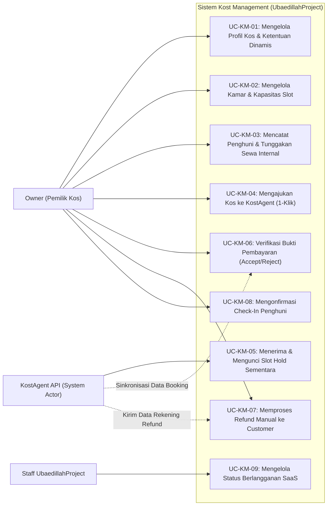
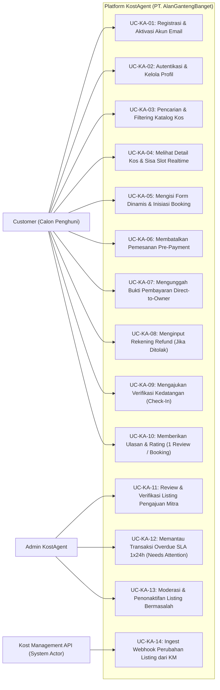

# DOKUMEN SPESIFIKASI USE CASE & ACTOR-PERMISSION MATRIX
## SISTEM TERPADU: KOST MANAGEMENT & KOSTAGENT
**Phase**: Phase 2 — System Analysis  
**Versi**: 1.0.0 | **Tanggal**: 2026-11-01  
**Referensi**: [functional-requirements.md](file:///e:/Allan/Kuliah/Kuliah%20Sem%203/Integrasi%20Sistem/Golden%20Tiket/kost-agent/docs/requirements/functional-requirements.md) & [ADR-000 s/d ADR-012](file:///e:/Allan/Kuliah/Kuliah%20Sem%203/Integrasi%20Sistem/Golden%20Tiket/kost-agent/docs/decisions/README.md)

---

## 1. DAFTAR AKTOR SISTEM (ACTORS)

Sistem membedakan aktor manusia dan aktor sistem berdasarkan batas kepemilikan:

### 1.1 Aktor pada Ekosistem Kost Management (UbaedillahProject)
1. **Owner (Pemilik Kos)**: Pengguna utama SaaS Kost Management. Bertanggung jawab mengelola properti, kamar, kapasitas, penghuni, pembayaran internal, mengajukan listing ke KostAgent, memverifikasi pembayaran sewa, dan mengeksekusi refund.
2. **Staff UbaedillahProject**: Operator internal platform SaaS Kost Management. Bertanggung jawab memonitor status berlangganan/membership pemilik kos dan melayani customer support teknis bagi pemilik kos.
3. **KostAgent Service (System Actor)**: Entitas sistem eksternal yang memanggil API Kost Management untuk revalidasi kamar, reservasi slot hold, pengiriman data booking, dan pengiriman permintaan refund.

### 1.2 Aktor pada Ekosistem KostAgent (PT. AlanGantengBanget)
1. **Customer (Calon Penghuni)**: Pengguna publik yang mencari kos, memfilter kamar, mengisi formulir pendaftaran dinamis, memesan slot kamar, mentransfer dana langsung ke owner, mengunggah bukti bayar, mengajukan verifikasi kedatangan, dan memberikan ulasan.
2. **Admin KostAgent**: Administrator platform publik KostAgent. Bertanggung jawab memverifikasi kelayakan listing properti yang diajukan owner, menangani penolakan listing, memoderasi listing bermasalah, memantau transaksi overdue SLA 24 jam, serta menegakkan prinsip *Minimum Access*.
3. **Kost Management Service (System Actor)**: Entitas sistem eksternal yang mengirimkan event webhook sinkronisasi kamar, status persetujuan booking (ACCEPT/REJECT), dan konfirmasi check-in/refund.

---

## 2. ACTOR-PERMISSION MATRIX (MATRIKS HAK AKSES)

| Kode Fitur / Kapabilitas Sistem | Customer | Owner (via KM) | Admin KostAgent | Staff UbaedillahProject |
| :--- | :---: | :---: | :---: | :---: |
| **Pencarian & Katalog Publik Kos** | ✅ Akses | ❌ (Bukan ranah) | ✅ Monitoring | ❌ (Bukan ranah) |
| **Registrasi & Kelola Akun Customer** | ✅ Mandiri | ❌ Dilarang | ❌ Dilarang | ❌ Dilarang |
| **Kelola Data Kos, Kamar & Harga Internal** | ❌ Dilarang | ✅ Pemilik Kos | ❌ Dilarang | ❌ Dilarang |
| **Kelola Data Ketentuan Dinamis Kos** | ❌ Dilarang | ✅ Pemilik Kos | ❌ Dilarang | ❌ Dilarang |
| **Kelola Data Keuangan & Tunggakan Penghuni** | ❌ Dilarang | ✅ Rahasia Owner | ❌ Dilarang | ❌ Dilarang |
| **Ajukan Kemitraan Kos ke KostAgent** | ❌ Dilarang | ✅ Per Kos | ❌ Dilarang | ❌ Dilarang |
| **Verifikasi & Approve/Reject Listing** | ❌ Dilarang | ❌ Dilarang | ✅ Kewenangan | ❌ Dilarang |
| **Inisiasi Booking & Hold Slot Kamar** | ✅ Mandiri | ❌ Dilarang | ❌ Dilarang | ❌ Dilarang |
| **Pembatalan Mandiri Pre-Payment (60m)** | ✅ Mandiri | ❌ Dilarang | ❌ Dilarang | ❌ Dilarang |
| **Unggah Bukti Transfer Sewa** | ✅ Mandiri | ❌ Dilarang | ❌ Dilarang | ❌ Dilarang |
| **Verifikasi Bukti Transfer (Accept/Reject)** | ❌ Dilarang | ✅ Pemilik Kos | ❌ Dilarang | ❌ Dilarang |
| **Input Nomor Rekening Refund** | ✅ Mandiri | ❌ Dilarang | ❌ Dilarang | ❌ Dilarang |
| **Eksekusi Transfer Refund ke Customer** | ❌ Dilarang | ✅ Manual Owner | ❌ Dilarang | ❌ Dilarang |
| **Konfirmasi Check-In Penghuni** | 🟡 Request | ✅ Konfirmasi | ❌ Dilarang | ❌ Dilarang |
| **Kirim Ulasan & Rating Kos** | ✅ Bersyarat | ❌ Dilarang | ❌ Dilarang | ❌ Dilarang |
| **Pantau Status Langganan SaaS Owner** | ❌ Dilarang | ✅ Akun Sendiri | ❌ Dilarang | ✅ Kewenangan |
| **Lihat Dokumen Pribadi Sensitif (KTP/NIK)** | ✅ Akun Sendiri | ✅ Penyewa Kosnya | 🔒 Sengketa Saja | ❌ Dilarang Keras |

*Keterangan Simbol:*\
✅ = Memiliki hak akses penuh.\
🟡 = Dapat mengajukan permintaan (request/trigger).\
🔒 = Dibatasi ketat (*Masked by default*), hanya dibuka dalam mode investigasi sengketa dengan audit log permanen.\
❌ = Tidak memiliki izin akses secara fungsional.

---

## 3. DIAGRAM USE CASE SISTEM

### 3.1 Diagram Use Case: Kost Management (Operasional Owner & SaaS)

### 3.2 Diagram Use Case: KostAgent (Platform Publik & Booking)

---

## 4. SPESIFIKASI DETAIL USE CASE KRITIS (HIGH-VALUE SPECIFICATIONS)

---

### UC-KM-02: Mengelola Kamar & Kapasitas Slot
- **Aktor Utama**: Owner (Pemilik Kos)
- **Deskripsi**: Owner menambah, mengubah, atau mengatur kapasitas kamar (privat atau bersama) menggunakan unit slot agregat.
- **Pre-conditions**:
  1. Owner telah terautentikasi di aplikasi Kost Management.
  2. Properti kos telah terdaftar.
- **Main Success Scenario**:
  1. Owner membuka menu *Kamar* pada properti kos terkait.
  2. Owner memasukkan nomor/nama kamar, tipe kamar (Privat / Bersama), ukuran kamar ($m^2$), fasilitas kamar, foto, harga sewa bulanan, dan total kapasitas slot ($N \ge 1$).
  3. Sistem memvalidasi bahwa nomor kamar unik dalam kos tersebut.
  4. Sistem menyimpan data kamar dengan inisialisasi: `total_capacity = N`, `occupied_slots = 0`, `reserved_slots = 0`, `status = TERSEDIA`.
  5. Jika kos sudah terintegrasi aktif dengan KostAgent, sistem otomatis memancarkan webhook sinkronisasi ke KostAgent.
- **Alternative / Exception Flow**:
  - *3a. Pengurangan Kapasitas di Bawah Jumlah Penghuni Aktif*: Jika owner mencoba mengecilkan `total_capacity` lebih rendah dari `occupied_slots + reserved_slots`, sistem menolak dan menampilkan pesan galat: *"Kapasitas tidak boleh lebih kecil dari jumlah slot yang sedang terisi atau ditahan"*.
- **Post-conditions**:
  - Kamar tersimpan di database Kost Management dan slot siap dialokasikan.

---

### UC-KM-05: Menerima & Mengunci Slot Hold Sementara (API Call)
- **Aktor Utama**: KostAgent Service (System Actor)
- **Deskripsi**: Kost Management menerima instruksi penguncian slot sementara (60 menit) dari KostAgent saat customer memulai alur pembayaran sewa.
- **Pre-conditions**:
  1. API request membawa Bearer Token / API Key yang valid.
  2. Kamar berada dalam status aktif dan tidak sedang maintenance.
- **Main Success Scenario**:
  1. Kost Management menerima request `POST /api/v1/rooms/{id}/hold-slots` dengan payload `requested_slots` dan `idempotency_key`.
  2. Kost Management membuka database transaction dengan row lock (`SELECT FOR UPDATE`).
  3. Sistem memeriksa: $(\text{total\_capacity} - \text{occupied\_slots} - \text{reserved\_slots}) \ge \text{requested\_slots}$.
  4. Kuota mencukupi: Sistem mengupdate `reserved_slots = reserved_slots + requested_slots` dan mencatat record `room_reservations` dengan status `HOLD` dan timestamp `expires_at = NOW() + 60 menit`.
  5. Transaksi di-commit dan sistem mengembalikan HTTP 200 `{ success: true, reservation_id: ... }`.
- **Alternative / Exception Flow**:
  - *3a. Kapasitas Tidak Mencukupi (Fail All)*: Jika sisa slot $< \text{requested\_slots}$, transaksi di-rollback dan sistem mengembalikan HTTP 409 Conflict: `{ error: "INSUFFICIENT_CAPACITY" }`.
  - *1a. Duplikasi Request (Idempotency Trigger)*: Jika `idempotency_key` sudah pernah diproses, sistem langsung mengembalikan respon reservasi sebelumnya tanpa menambah hitungan kuota.
- **Post-conditions**:
  - Slot kamar aman terkunci di Source of Truth selama 60 menit dari alokasi offline.

---

### UC-KA-05: Mengisi Form Dinamis & Inisiasi Booking
- **Aktor Utama**: Customer (Calon Penghuni)
- **Deskripsi**: Customer memilih kamar, durasi, tanggal masuk, mengisi syarat ketentuan dinamis untuk seluruh penghuni, dan menerbitkan pemesanan.
- **Pre-conditions**:
  1. Customer telah login dan akun terverifikasi.
  2. Listing kos berstatus `ACTIVE`.
- **Main Success Scenario**:
  1. Customer memilih kamar, jumlah slot ($N$), tanggal rencana masuk, dan durasi sewa (bulan).
  2. KostAgent mengambil skema ketentuan kos dari cache/API Kost Management (ADR-009).
  3. KostAgent me-render input formulir dinamis secara berulang sebanyak $N$ slot penghuni (Penghuni 1, Penghuni 2, dst.).
  4. Customer mengisi lengkap identitas dan mencentang syarat untuk setiap penghuni, lalu menekan tombol "Ajukan Pemesanan".
  5. KostAgent memanggil API Kost Management untuk mengunci slot hold real-time selama 60 menit (UC-KM-05).
  6. Setelah hold berhasil di Kost Management, KostAgent menyimpan record booking berstatus `PENDING PAYMENT`, mengaktifkan countdown timer 60 menit, dan menampilkan nomor rekening/QRIS pemilik kos beserta total tagihan.
- **Alternative / Exception Flow**:
  - *5a. Hold Gagal karena Slot Habis*: Sistem membatalkan proses checkout dan menampilkan notifikasi: *"Mohon maaf, slot kamar ini baru saja terisi penuh oleh pemesan lain"*.
- **Post-conditions**:
  - Booking berstatus `PENDING PAYMENT` terdaftar di KostAgent dan slot ter-hold di Kost Management.

---

### UC-KA-06: Membatalkan Pemesanan Pre-Payment (ADR-001)
- **Aktor Utama**: Customer (Calon Penghuni)
- **Deskripsi**: Customer membatalkan pemesanan secara mandiri sebelum melakukan pembayaran / sebelum upload bukti transfer.
- **Pre-conditions**:
  1. Booking berstatus `PENDING PAYMENT`.
  2. Sisa timer countdown $> 0$ menit (belum kedaluwarsa).
- **Main Success Scenario**:
  1. Customer menekan tombol "Batalkan Pemesanan" pada halaman pembayaran.
  2. Sistem memvalidasi status booking saat ini. Karena status `PENDING PAYMENT`, pembatalan disetujui.
  3. KostAgent mengubah status booking lokal menjadi `CANCELLED`.
  4. KostAgent memanggil endpoint Kost Management `POST /api/v1/rooms/{id}/release-slots` untuk membatalkan reservasi hold.
  5. Kost Management mengurangi `reserved_slots` seketika. Slot kembali tersedia untuk publik.
  6. Customer diarahkan kembali ke dashboard pemesanan dengan status dibatalkan.
- **Alternative / Exception Flow**:
  - *2a. Status Sudah Berubah Menjadi PAYMENT SUBMITTED*: Jika customer sudah sempat mengunggah bukti bayar, tombol pembatalan dikunci dan sistem memunculkan peringatan: *"Pembayaran sudah disubmit. Pembatalan hanya dapat diproses melalui verifikasi pemilik kos"*.
- **Post-conditions**:
  - Slot kamar instan lepas kembali ke publik.

---

### UC-KM-06: Verifikasi Bukti Pembayaran (Accept/Reject)
- **Aktor Utama**: Owner (Pemilik Kos)
- **Deskripsi**: Owner memeriksa mutasi transfer bank/e-wallet miliknya dan mencocokkannya dengan bukti pembayaran yang diunggah customer.
- **Pre-conditions**:
  1. Pemesanan berstatus `PAYMENT SUBMITTED`.
  2. Belum melewati batas verifikasi atau berstatus `NEEDS ATTENTION`.
- **Main Success Scenario (ACCEPT)**:
  1. Owner membuka detail booking di Kost Management dan melihat lampiran gambar bukti transfer serta total nominal sewa.
  2. Owner menekan tombol **"ACCEPT (Terima Pemesanan)"**.
  3. Kost Management mengubah status reservasi kamar dari `HOLD` menjadi `CONFIRMED OCCUPANCY`. Slot `reserved_slots` dipindahkan secara permanen ke `occupied_slots`.
  4. Kost Management memicu webhook ke KostAgent bahwa booking telah berstatus `ACCEPTED`.
  5. KostAgent mengaktifkan tenggat waktu check-in 14 hari ($H+14$) dan mengirimkan notifikasi ke customer.
- **Alternative Scenario (REJECT)**:
  - *2a. Owner Memilih REJECT*:
    1. Owner menekan tombol **"REJECT (Tolak Pemesanan)"** dan wajib memilih/mengetik alasan penolakan (misal: "Dana mutasi tidak masuk", "Kamar tidak lolos kualifikasi gender", dll.).
    2. Kost Management melepaskan slot hold kamar (`reserved_slots = reserved_slots - N`). Slot kembali tersedia.
    3. Kost Management memancarkan webhook ke KostAgent berstatus `REJECTED` beserta alasan tertulis.
    4. KostAgent mengubah status pemesanan menjadi `REJECTED` dan membuka formulir pengumpulan nomor rekening refund untuk customer (UC-KA-08).
- **Post-conditions**:
  - Booking berstatus final `ACCEPTED` atau dialihkan ke alur refund (`REJECTED`).

---

### UC-KM-07: Memproses Refund Manual ke Customer (ADR-012)
- **Aktor Utama**: Owner (Pemilik Kos)
- **Deskripsi**: Owner mentransfer balik dana yang sebelumnya dikirim customer untuk booking yang ditolak atau dibatalkan sesuai prosedur.
- **Pre-conditions**:
  1. Booking berstatus `REJECTED` atau pembatalan sah dengan denda.
  2. Customer telah menginput data rekening bank/e-wallet refund di KostAgent.
- **Main Success Scenario**:
  1. Kost Management menerima data rekening tujuan transfer (Nama Bank/e-Wallet, No Rekening, Nama Pemilik Rekening) dari webhook KostAgent.
  2. Owner melihat instruksi refund dan nominal pengembalian pada tab *Penyelesaian Refund*.
  3. Owner melakukan transfer manual melalui aplikasi mobile banking miliknya ke rekening customer dalam target SLA 1×24 jam.
  4. Owner kembali ke Kost Management dan menekan tombol **"Konfirmasi Refund Telah Ditransfer"** (dapat menyertakan nomor referensi bank).
  5. Kost Management memperbarui status menjadi `REFUND_COMPLETED` dan mengirimkan event pembaruan ke KostAgent.
  6. KostAgent menampilkan konfirmasi status kepada customer bahwa dana telah dikembalikan oleh pemilik.
- **Post-conditions**:
  - Kewajiban finansial selesai dan tercatat rapi di kedua sistem.

---

### UC-ADM-01: Review & Verifikasi Listing Pengajuan Mitra
- **Aktor Utama**: Admin KostAgent
- **Deskripsi**: Admin memeriksa kelayakan data kos, foto kamar, harga, kontak, dan ketentuan yang diajukan owner sebelum diterbitkan ke katalog publik.
- **Pre-conditions**:
  1. Owner telah mengajukan properti kos dari Kost Management (status `WAITING_REVIEW`).
  2. Admin login di portal admin KostAgent.
- **Main Success Scenario**:
  1. Admin membuka antrean pengajuan kemitraan di dashboard admin.
  2. Admin memeriksa kelengkapan data: foto properti, fasilitas, nomor WhatsApp aktif, rincian kamar, dan kewajaran harga.
  3. Admin menekan tombol **"APPROVE LISTING"**.
  4. Sistem mengubah status kemitraan properti menjadi `ACTIVE`.
  5. Properti dan daftar kamarnya seketika tayang di katalog pencarian publik KostAgent.
  6. KostAgent memicu webhook status kemitraan `ACTIVE` ke Kost Management.
- **Alternative Flow (REJECT & FEEDBACK)**:
  - *3a. Data Kurang Lengkap atau Foto Buram*: Admin menekan **"REJECT WITH FEEDBACK"** dan menginput catatan kekurangan data (misal: "Foto kamar tidur utama wajib diunggah ulang karena buram").
  - Status kemitraan berubah menjadi `REJECTED`. Notifikasi alasan penolakan dikirim ke Kost Management agar owner dapat memperbaikinya dan mengajukan ulang (*Re-submit*).
- **Post-conditions**:
  - Listing aktif di katalog publik atau dikembalikan ke owner untuk revisi.

---

### UC-ADM-02: Memantau Transaksi Overdue SLA 1x24h (Flag Needs Attention) (ADR-003)
- **Aktor Utama**: Admin KostAgent
- **Deskripsi**: Admin memantau transaksi yang bukti bayarnya sudah diunggah tetapi belum diverifikasi oleh pemilik kos melebihi 24 jam.
- **Pre-conditions**:
  1. Booking berstatus `PAYMENT SUBMITTED`.
  2. Waktu verifikasi telah melewati 24 jam kalender sejak upload bukti bayar.
- **Main Success Scenario**:
  1. Background cron worker menandai booking dengan status flag `NEEDS ATTENTION`.
  2. Item booking muncul di baris teratas antrean perhatian khusus dashboard Admin KostAgent dengan badge merah.
  3. Admin membuka detail kontak owner yang tercantum pada properti kos terkait.
  4. Admin melakukan follow-up manual melalui WhatsApp/telepon resmi kepada pemilik kos untuk segera memverifikasi transaksi customer di Kost Management.
  5. Slot kamar tetap dipertahankan dan dana customer tidak digantung sepihak.
- **Post-conditions**:
  - Transaksi tertangani melalui intervensi operasional admin tanpa merusak status alokasi kamar.

---

Dokumen spesifikasi Use Case dan Matriks Hak Akses ini siap menjadi landasan langsung untuk tahap berikutnya: **Perancangan Skema Database (ERD) untuk Kost Management dan KostAgent**.
